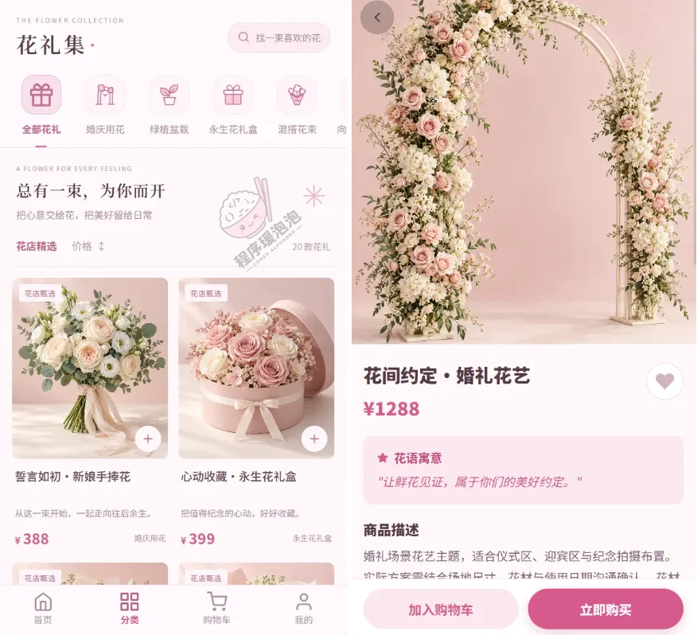
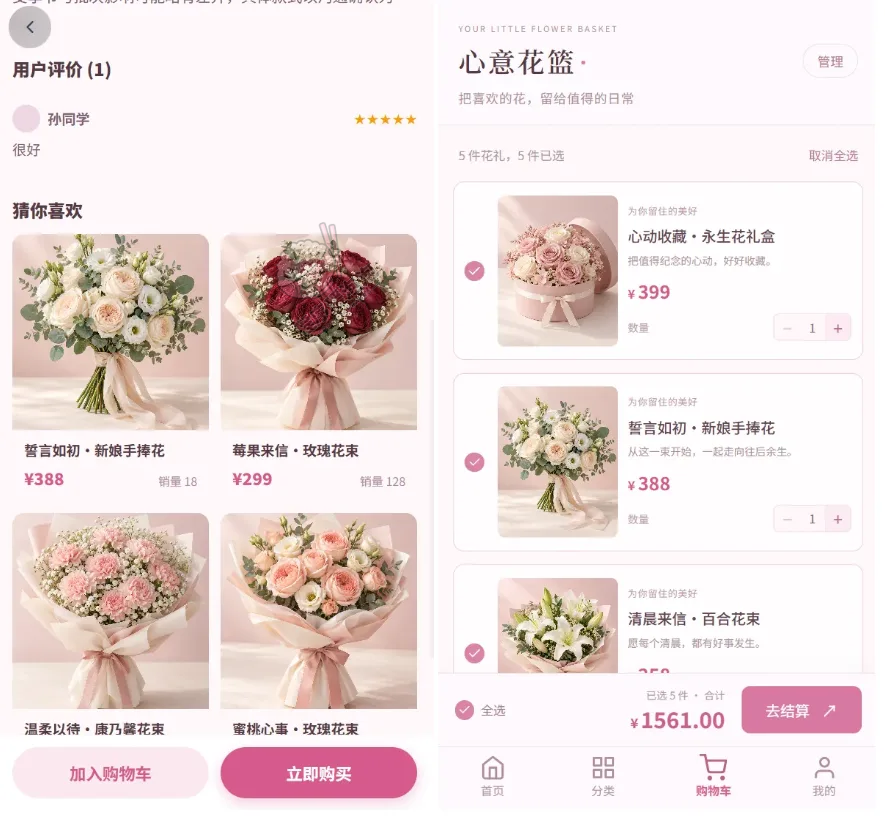
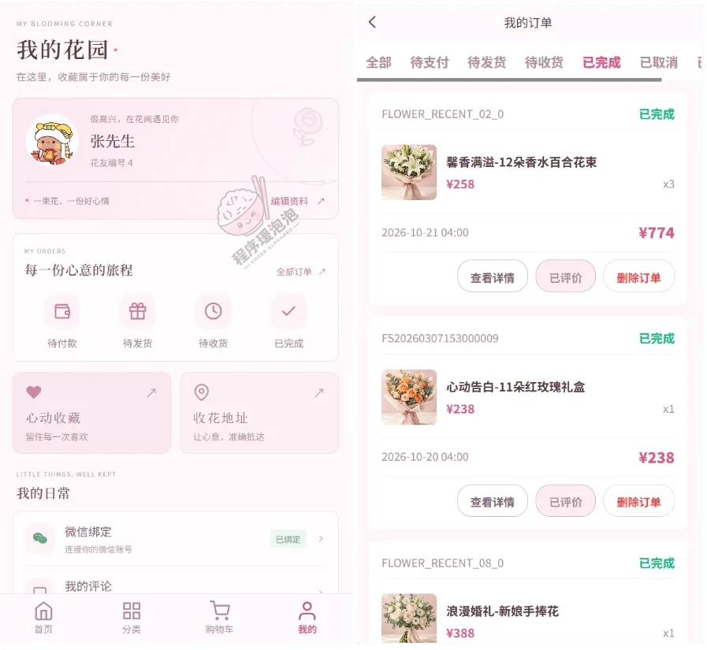
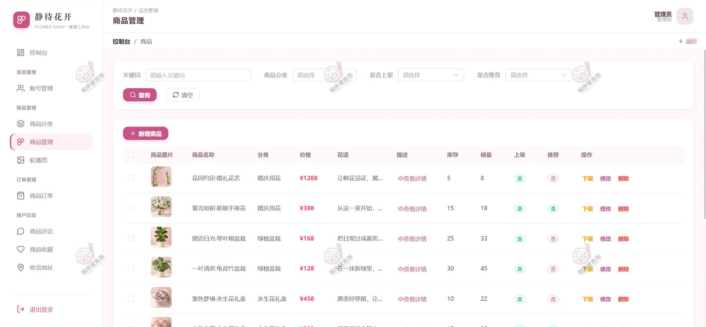
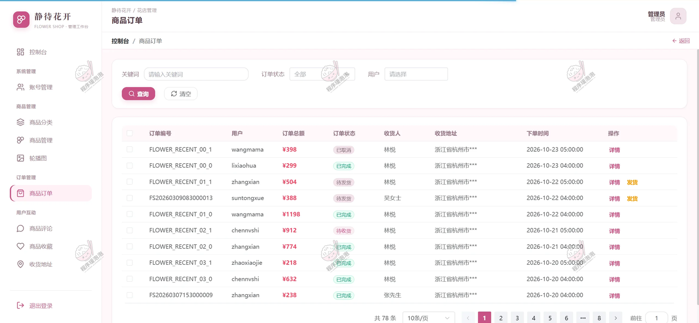
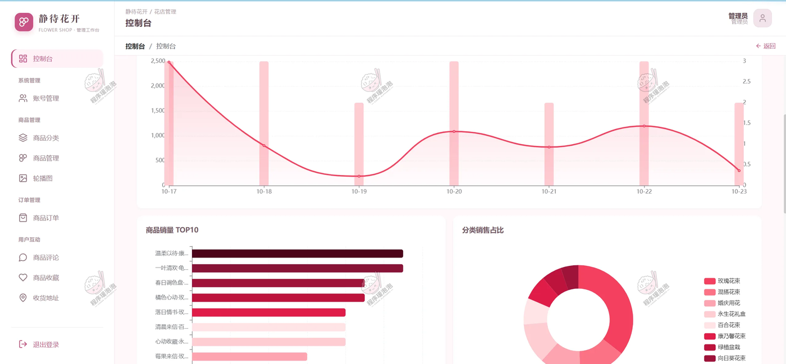

# FlowerShop
鲜花销售商城小程序
亮点：同分类与热销推荐算法、HanLP评论热词分析、ECharts运营分析、鲜花选购流程； 可加ai功能，免费；
角色：用户、管理员；

所有源码均本人开发，项目是前后端分离的，所有的项目都具备了完整的业务逻辑，不仅仅局限于基础的增删改查（CRUD）操作，系统亮点众多。

本文注重于计算机毕业设计选题指导，列出题目均有源码， 大家可以去【公众号】(毕业终点站)获取或者加我【qq】(2112698948)提意见(别忘记Star哟)。备注：git

声明：仅用于学习使用，请勿用于任何商业行为！

1.系统非商用，非开源，非无偿。

2.由本人开发，如需源码，请联系以下方式，qq:2112698948。 https://home.biyecode.com/

3.项目有很多，并未全部上传，如果未找到想要的，可直接咨询。

# 鲜花销售商城小程序

基于微信小程序 + 管理后台的花店电商系统，围绕花卉分类、花语与送花需求，把商品浏览、收藏、购物车、下单、模拟支付、后台发货、确认收货和评价串成一条选购流程。小程序端面向顾客，管理员端负责商品、订单维护和运营数据分析。

## 项目简介

- **架构**：B/S、MVC、前后端分离，微信小程序端 + 管理后台，管理员与普通用户双角色
- **开发环境**：IDEA、JDK17、Maven、MySQL、Node.js、HBuilderX、微信开发者工具
- **后端技术**：Java、Spring Boot 3、Spring MVC、MyBatis-Plus、MySQL、JWT、HanLP 中文分词
- **后台技术**：Vue 3、Vite、Element Plus、Vue Router、Pinia、Axios、ECharts、echarts-wordcloud
- **小程序技术**：uni-app、Vue 3、Pinia、微信小程序 API、uni-ui 组件

## 系统亮点

- **同分类与热销推荐算法**：优先推荐当前商品同分类的在售商品并按销量排序，不足六件时用全局热销商品补齐，排除当前商品和重复商品。
- **鲜花选购流程**：围绕花卉分类、花语与送花需求，串联商品浏览、收藏、购物车、下单、模拟支付、后台发货、确认收货和评价，完整展示花店业务。
- **HanLP 评论热词分析**：对真实商品评价做中文分词，过滤单字和标点后统计词频，提取前 80 个热词生成词云，展示顾客对鲜花、包装和配送的反馈。
- **ECharts 运营分析**：六类图表覆盖销售、商品、分类、订单与评价；销售额和分类销售统计基于已完成订单及历史明细金额，避免商品调价影响历史数据。

## 系统功能

### 普通用户端

- 账号注册登录、找回密码、个人资料维护、修改密码与退出登录
- 首页轮播、花卉分类、关键词搜索、商品详情、花语展示、商品推荐
- 商品收藏、购物车数量调整与勾选结算、立即购买
- 收货地址新增编辑、删除与默认地址设置，确认订单时选择地址、配送时间和留言
- 模拟支付演示、订单状态筛选、订单详情、取消待支付订单、确认收货与评分评价
- 个人中心查看我的订单、收藏与评论

### 管理员端

- 数据看板：用户、商品、订单、销售额、评论、收藏六项指标，近七天销售与订单趋势、商品销量 TOP10、分类销售占比、订单状态分布、评分分布、评论词云
- 用户管理：条件查询、分页、新增编辑、删除、启用禁用、重置密码
- 花卉分类管理：维护分类名称、图标、说明与排序
- 商品管理：维护花束、永生花、绿植与婚庆花艺，支持图片、花语、价格、库存、上下架及推荐设置
- 订单管理：查看订单与商品明细、收货信息、订单状态，填写配送信息并发货
- 互动与内容管理：商品评论、收藏记录、购物车记录、收货地址及首页轮播图管理
- 账号设置：个人信息维护、修改密码、退出登录

## 系统截图

> 源文档未提供登录页和独立的系统总览图，以下按用户端、管理员端依次展示。小程序端截图为双屏拼图（同一张图并排展示两个手机页面），按整张全宽呈现。

### 一、普通用户端

**首页**

首页含搜索、活动轮播、婚庆用花/绿植盆栽/永生花礼盒等花卉分类入口，以及"为你精选"商品流（名称、花语、价格）。

**鲜花分类与商品详情**

分类页按花礼类型筛选商品，可加入购物车；商品详情展示大图、花语寓意和商品描述，提供加入购物车与立即购买入口。

**猜你喜欢与购物车**

商品详情下方"猜你喜欢"按同分类推荐（含销量），购物车支持勾选商品、调整数量、取消全选和合计结算。

**个人中心与我的订单**

个人中心汇集订单状态入口、心动收藏、收花地址等；我的订单按待支付、待发货、待收货、已完成、已取消筛选，可查看详情、评价或删除订单。

### 二、管理员端

**商品管理**

按关键词、分类、上架状态、是否推荐筛选商品，维护商品图片、名称、分类、价格、花语、库存、销量，支持上架/下架、推荐设置、新增、修改和删除。

**商品订单**

按订单状态和用户筛选订单，查看订单编号、总额、状态、收货人和地址，对待发货订单执行发货操作。

**控制台数据分析**

数据看板展示近七天销售与订单趋势、商品销量 TOP10、分类销售占比等图表，从销售和商品维度呈现平台运营情况。

---

文档展示 7 张截图，需要了解更多，请联系我。
